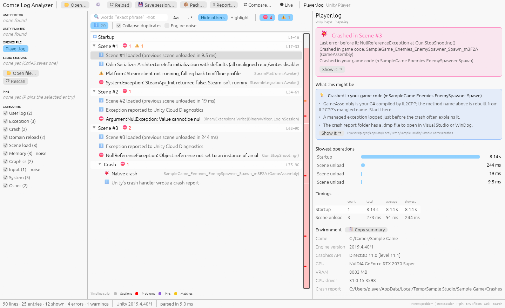
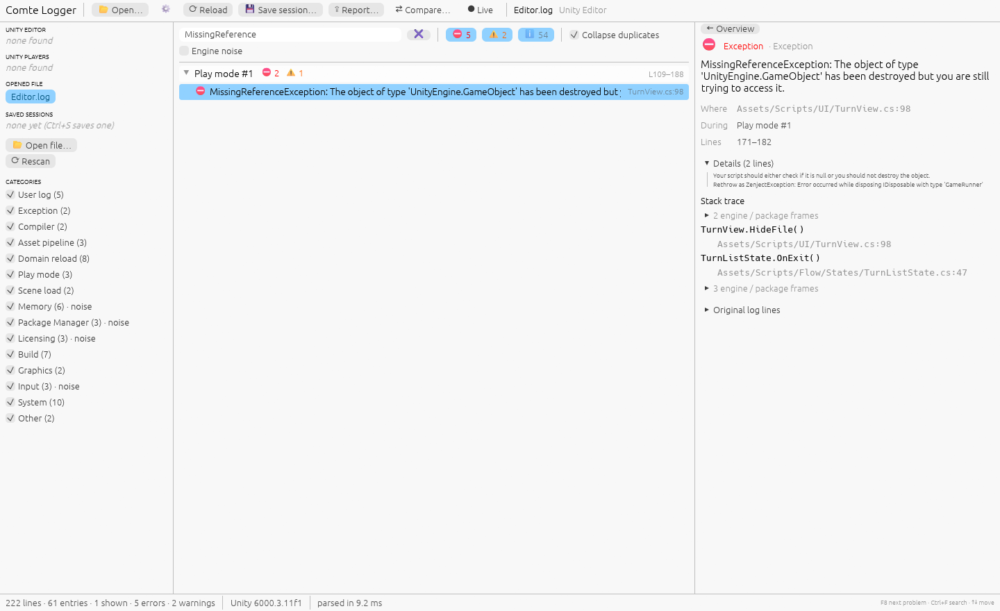
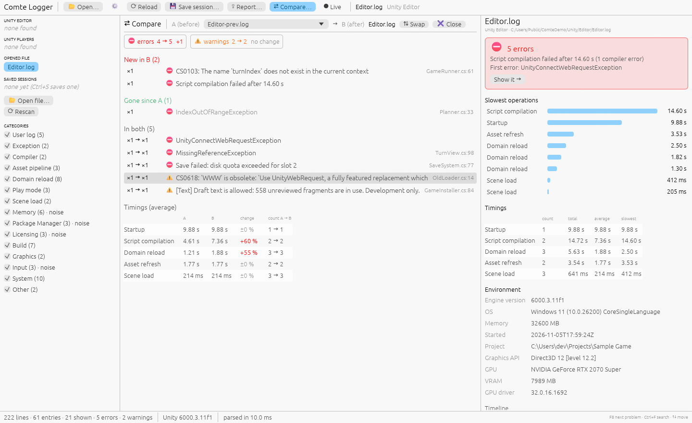

# Comte Log Analyzer

A Windows desktop app that turns Unity's noisy `Editor.log` and `Player.log` into something a person can read.

*« Savoir pour prévoir »* (Auguste Comte): know the log so you can predict the bug.

## Install and run

- **Windows:** download `comte-log-analyzer-…-windows-x64.exe` from the [latest release](https://github.com/cosgunhalil/comte-log-analyzer/releases/latest) and run it.
- **From source** (Rust 1.95+, MSVC toolchain): `cargo install --locked --git https://github.com/cosgunhalil/comte-log-analyzer comte-app`

With no file given it opens your current Unity `Editor.log`; drop any other log onto the window, or press Ctrl+O.

Windows warns about the download?

The exe isn't code-signed yet, so SmartScreen may ask you to confirm, and
Defender sometimes flags a new release (a false positive, reported to
Microsoft each time). Releases are built by
[GitHub Actions](https://github.com/cosgunhalil/comte-log-analyzer/actions)
from the tagged source; check a download with the [GitHub CLI](https://cli.github.com):
`gh attestation verify <file> --repo cosgunhalil/comte-log-analyzer`

## Will it read my log?

| | Tested with |
|---|---|
| **Player.log** | 25 games built with Unity 2019.4, 2020.3, 2021.3, 2022.3 and Unity 6 (6000.0–6000.3) |
| **Editor.log** | Unity 6000.3 (older versions not yet checked against real logs) |
| **Platform** | Windows only for now; macOS and Linux are not built or tested yet |

## Features

| | |
|---|---|
| **Finds your logs** | Editor and Player logs on this machine, the previous run's, and related logs such as `upm.log` and the import workers' logs |
| **Readable timeline** | Startup, compiles, domain reloads, Play mode and scenes; engine chatter hidden, repeats collapsed (×95), your stack frames in bold |
| **A verdict first** | "Crashed in Scene #3", "103 errors (4 different)", or "⏳ Stopped while importing Assets/Hero.fbx" when Unity got stuck |
| **Explains known problems** | Native crashes traced to a GPU driver, your IL2CPP code, the engine or a plugin; out of memory, a removed graphics device, a full disk, Package Manager, Gradle and licensing failures |
| **Search and navigation** | Words, `"phrases"` and `-exclusions`, highlighting, a timeline strip, pins with notes, and keyboard shortcuts for everything |
| **Performance** | Slowest operations and asset imports, build size by asset, and a warning when domain reloads get slower than your last sessions |
| **Huge and live logs** | Logs of many gigabytes open from their end; ● Live follows Unity as it writes |
| **Save, share, compare** | Sessions with notes and tags, a support pack zip and Markdown/Slack reports, all redacted by default; ⇄ Compare with the previous run |
| **Takes you to the code** | Click `TurnView.cs:98` (or Ctrl+E) to open it in Rider, VS Code or Visual Studio |

The [user guide](docs/USAGE.md) has the full list, the keyboard shortcuts, the settings and the command line.

| | |
|---|---|
|  |  |
| Exception details with links into the project | Comparing the previous and the current Editor run |

## Documentation

| Document | What's in it |
|---|---|
| [User guide](docs/USAGE.md) | Every feature, keyboard shortcuts, settings, the `comte` command line |
| [Design](docs/DESIGN.md) | How each feature works and the parsing rules learned from real logs |
| [Contributing](CONTRIBUTING.md) | Building from source, tests, project layout, how to submit a change |
| [Releasing](RELEASING.md) | Versioning and the release pipeline |
| [Changelog](CHANGELOG.md) | What changed in each release |
| [Security](SECURITY.md) | How to report a security problem privately, such as a value the redaction misses |

Everyone taking part follows the [Code of Conduct](CODE_OF_CONDUCT.md).

## License

Licensed under either of [Apache License, Version 2.0](LICENSE-APACHE) or
[MIT license](LICENSE-MIT) at your option. Unless you explicitly state
otherwise, any contribution intentionally submitted for inclusion in the work
by you, as defined in the Apache-2.0 license, shall be dual licensed as above,
without any additional terms or conditions.
